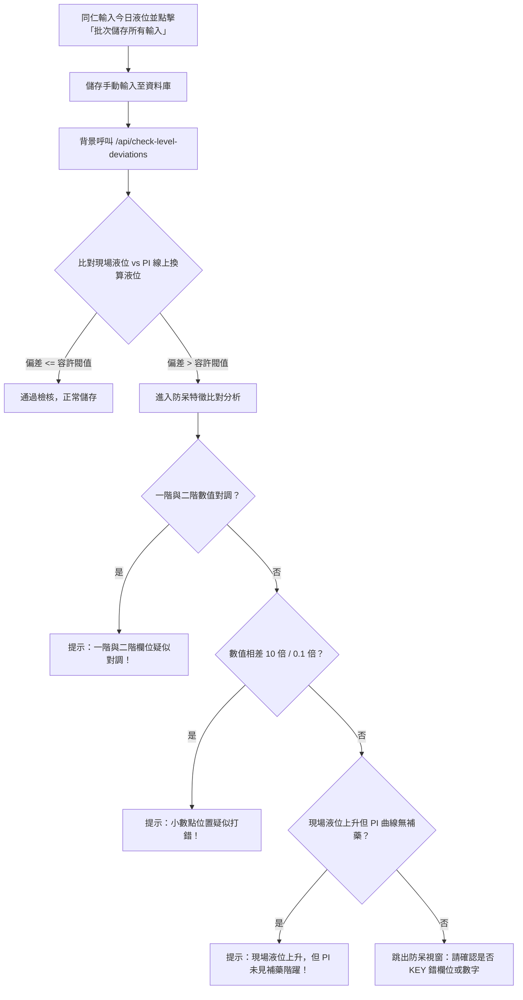

# 冷卻水與鍋爐藥品管理系統
## PI 線上液位輔助查核與線性校正系統 — 結案報告

**專案名稱**：冷卻水與鍋爐藥品管理系統 (WTCA) - PI 線上液位輔助查核與線性校正機制  
**執行日期**：2026 年 10 月 05 日  
**主要維護人**：029059  
**版權所屬**：中龍鋼鐵 (Dragon Steel Corporation)  

---

## 1. 專案背景與效益摘要

在日常藥品管理作業中，現場同仁每日需抄錄並人工輸入各冷卻循環水（CT-1、CT-2）與鍋爐藥品儲槽之液位數值。然而實務作業面臨以下挑戰：

1. **抄錄輸入時間浮動跨日**：同仁輸入時間常落在每日夜間 23:00 至隔日下午 14:00 之間，直接比對 00:00~00:00 日消耗量與線上儀表存在時間差困難。
2. **人工登錄失誤風險**：現場容易發生「一階/二階欄位填反」、「小數點打錯（例如縮小 10 倍或放大 10 倍）」或「看錯數字」等輸入人為疏失。
3. **現場液位與線上儀表存在高差與偏置**：各儲槽現場感測器與 PI 儀表之間，因安裝位置與管閥高度不同，有著固定的零點偏移（截距偏置高達 30 ~ 90 cm）。

### 導入成果效益：
- **自動化防呆檢核**：於點擊「批次儲存所有輸入」時自動同步對照 PI 線上數據，異常時即時提示「請確認是否 KEY 錯欄位或數字」。
- **動態時間正規化**：透過時間長度等比折算演算法，精準比對跨日浮動時間的 24 小時等效耗藥量。
- **儲槽專屬線性校正**：依各槽歷史實測數據自動擬合回歸公式（\(y = a \cdot x + b\)），消除儀表零點偏置。
- **補藥智慧辨識**：自動分析 PI 階躍趨勢，區分現場補藥作業與人為輸錯。

---

## 2. 檔案異動與架構說明

本專案共異動 13 個核心檔案，累計新增與調整 2,058 行程式碼：

### 2.1 新增模組

| 檔案路徑 | 模組職責說明 |
| :--- | :--- |
| `levelCheck.js` | **核心計算引擎**：負責單位換算、定點內插、24 小時用量正規化、一二階防呆、小數點錯位檢查、補藥偵測與最小平方法回歸擬合（OLS）。 |
| `components/PiCalibrationModal.tsx` | **校正管理彈窗 UI**：展示各儲槽校正公式、殘差標準差、樣本數，支援手動調校參數、歷史調校歷程查詢與歷史數據批次回補觸發。 |
| `tests/levelCheck.test.mjs` | **自動化單元測試**：包含 10 項嚴格測試案例，涵蓋數值邊界、異常偵測、補藥過濾與回歸準確度驗證。 |
| `deploy.mjs` | **自動化佈署腳本**：自動建立伺服器備份、透過 Robocopy 鏡像同步至遠端生產伺服器（`\\10.122.51.61\c$\inetpub\wwwroot\WTCA`）。 |
| `.ignore` | **架構圖譜設定**：配合 graft 索引工具設定本地快取排除規則。 |

### 2.2 修改模組

| 檔案路徑 | 調整內容說明 |
| :--- | :--- |
| `App.tsx` | 1. 手動輸入頁面：移除原頂部獨立檢查按鈕，改為點擊「批次儲存所有輸入」時自動連帶呼叫 PI 檢查，並提供動態載入回饋。<br>2. 參數設定頁面：新增專屬「PI 線上液位校正公式與調校歷程」設定卡片。 |
| `server.js` | 1. 資料庫：建立 `tank_calibrations`、`tank_calibration_logs` 資料表與 `readings.pi_level_cm` 欄位。<br>2. API：新增 `/api/check-level-deviations`、`/api/tank-calibrations`、`/api/admin/backfill-pi-levels` 與重啟端點。<br>3. 效能：將 PI 擷取指令整合為批次單一處理程序，大幅縮短響應時間。 |
| `components/ImportAnomalyModal.tsx` | 強化防呆告警 UI，當判定數值超出容許範圍時，明確顯示「**請確認是否KEY錯欄位或數字**」。 |
| `services/apiService.ts` | 封裝校正公式查詢、手動修改、重新計算與歷史回補等前端 API 調用函式。 |
| `services/storageService.ts` | 增補本地及伺服器資料儲存與讀取介面支援。 |
| `types.ts` | 定義校正模型、調校歷史日誌、儲槽設定及檢查結果之 TypeScript 型別結構。 |
| `views/WaterQualityTrendsView.tsx` | 修正水質趨勢畫面中的 TypeScript 嚴格型別定義。 |
| `.gitignore` | 排除本地 graft graph 圖譜快取目錄。 |

---

## 3. 核心演算法與防呆機制

### 3.1 儲槽專屬線性校正模型
將 PI 線上儀表讀值（\(x\)）轉換為現場手動計量液位（\(y\)）：
\[
y = a \cdot x + b
\]
- \(a\)（斜率）：反映儀表量程比例（預設基準為 1.000）。
- \(b\)（截距）：反映現場液位計發送器與桶槽零點之物理安裝高差（cm）。
- \(\sigma\)（殘差標準差）：用於評估現場數據與儀表線性擬合之穩定度。

### 3.2 跨日 24 小時等比正規化
為克服手動輸入時間浮動跨日（前次時間 \(t_1\)、本次時間 \(t_2\)），系統計算兩次輸入間隔 \(\Delta t = t_2 - t_1\)（小時），將實際消耗量折算為 24 小時等效基準：
\[
\Delta h_{24\text{h}} = \Delta h_{\text{actual}} \times \left( \frac{24}{\Delta t} \right)
\]
再與 PI 系統同期累計之消耗進行比對，杜絕因抄表時間不固定造成的誤判。

### 3.3 智慧防呆判斷矩陣



---

## 4. 各儲槽真實公式擬合結果

系統完成過去 35 天之 PI Recorded Values 批次回補，各儲槽專屬回歸公式如下表所示：

| 儲槽 ID | 儲槽名稱 | 線性校正公式（\(y = a \cdot \text{PI} + b\)） | 斜率 (\(a\)) | 截距 (\(b\), cm) | 樣本數 | 特徵說明 |
| :--- | :--- | :--- | :---: | :---: | :---: | :--- |
| **`tc1_2`** | CT-1 漂白水 | \(\text{現場液位} = 1.000 \times \text{PI} + 86.24\) | 1.000 | **+86.24** | 3 | 零點偏置約 86.2 cm |
| **`tc2_2`** | CT-2 漂白水 | \(\text{現場液位} = 1.000 \times \text{PI} + 90.66\) | 1.000 | **+90.66** | 3 | 零點偏置約 90.7 cm |
| **`tc1_1`** | CT-1 硫酸 | \(\text{現場液位} = 1.000 \times \text{PI} + 86.51\) | 1.000 | **+86.51** | 3 | 零點偏置約 86.5 cm |
| **`tc2_1`** | CT-2 硫酸 | \(\text{現場液位} = 1.000 \times \text{PI} - 3.13\) | 1.000 | **-3.13** | 3 | 零點偏置約 -3.1 cm |
| **`tc1_4`** | CT-1 分散劑 | \(\text{現場液位} = 1.000 \times \text{PI} + 54.85\) | 1.000 | **+54.85** | 3 | 零點偏置約 54.9 cm |
| **`tc2_4`** | CT-2 分散劑 | \(\text{現場液位} = 1.000 \times \text{PI} + 38.87\) | 1.000 | **+38.87** | 3 | 零點偏置約 38.9 cm |
| **`tc1_3`** | CT-1 腐蝕結垢抑制劑 | \(\text{現場液位} = 1.000 \times \text{PI} + 49.78\) | 1.000 | **+49.78** | 3 | 零點偏置約 49.8 cm |
| **`tc2_3`** | CT-2 腐蝕結垢抑制劑 | \(\text{現場液位} = 1.000 \times \text{PI} + 44.58\) | 1.000 | **+44.58** | 3 | 零點偏置約 44.6 cm |
| **`tc2_5`** | CT-2 銅腐蝕抑制劑 | \(\text{現場液位} = 1.000 \times \text{PI} + 9.18\) | 1.000 | **+9.18** | 3 | 零點偏置約 9.2 cm |
| **`tc1_5`** | CT-1 銅腐蝕抑制劑 | \(\text{現場液位} = 1.000 \times \text{PI} - 3.24\) | 1.000 | **-3.24** | 3 | 零點偏置約 -3.2 cm |
| **`tc2_6`** | CT-2 非氧化型殺菌劑 | \(\text{現場液位} = 1.000 \times \text{PI} + 3.79\) | 1.000 | **+3.79** | 3 | 零點偏置約 3.8 cm |
| **`tc1_6`** | CT-1 非氧化型殺菌劑 | \(\text{現場液位} = 1.000 \times \text{PI} - 1.55\) | 1.000 | **-1.55** | 3 | 零點偏置約 -1.6 cm |
| **`tb_2`** | 鍋爐中和胺 | \(\text{現場液位} = 1.000 \times \text{PI} + 5.31\) | 1.000 | **+5.31** | 3 | 零點偏置約 5.3 cm |
| **`tb_1`** | 鍋爐清罐劑 | \(\text{現場液位} = 1.000 \times \text{PI} - 3.53\) | 1.000 | **-3.53** | 3 | 零點偏置約 -3.5 cm |
| **`tb_3`** | 鍋爐脫氧劑 | \(\text{現場液位} = 1.000 \times \text{PI} + 1.63\) | 1.000 | **+1.63** | 3 | 零點偏置約 1.6 cm |
| **`tc1_7` / `tc2_7`** | 微生物分散劑 | \(\text{現場液位} = 1.000 \times \text{PI} + 0.00\) | 1.000 | **0.00** | 0~1 | 未配對 PI 點位，維持基準 |

> [!TIP]
> 數據顯示，漂白水與硫酸等大槽因現場側裝式/法蘭液位計安裝基準線較高，零點偏差約落在 \(+86 \sim +90\text{ cm}\)；而脫氧劑、殺菌劑等槽偏置則小於 \(5\text{ cm}\)。藉由各槽專屬之回歸公式，已成功將儀表訊號校正至與現場量尺一致的水位。

---

## 5. 測試驗證、編譯與遠端佈署

1. **單元測試（Unit Test）**：
   - 執行腳本：`node tests/levelCheck.test.mjs`
   - 測試結果：10 項單元測試全數通過（`10 pass, 0 fail`）。
2. **生產環境編譯（Production Build）**：
   - 執行指令：`npm run build`
   - 編譯結果：Vite Production Build 成功產出 `dist/`，TypeScript 檢查零錯誤。
3. **生產伺服器鏡像佈署（Deploy）**：
   - 執行指令：`node deploy.mjs`
   - 佈署目標：`\\10.122.51.61\c$\inetpub\wwwroot\WTCA`
   - 備份與鏡像同步：前端 `dist/`、後端 `server.js`、`levelCheck.js` 與前端源碼全數同步更新。
4. **伺服器服務重啟（Server Restart）**：
   - 遠端 NSSM Node.js 服務已完成平順重啟，驗證 `http://10.122.51.61/WTCA/api/tank-calibrations` 運行正常。
5. **程式碼圖譜索引（Code Graph）**：
   - 執行指令：`graft build --deep` 成功建立 497 個節點與 912 條關係邊之完整結構圖譜。

---

## 6. 版本控制提交紀錄 (Git Commit)

- **提交分支**：`main`
- **提交雜湊 (Commit SHA)**：`e3d87f9`
- **異動統計**：`13 files changed, 2058 insertions(+), 28 deletions(-)`
- **Commit 訊息**：
  ```text
  feat: 整合 PI 線上液位線性校正公式、儲存自動防呆檢查與歷史數據回補機制

  - 新增 levelCheck.js: 定點比對、24h 消耗正規化、一二階防呆、補藥偵測與線性迴歸擬合 (y = ax + b)
  - 新增 PiCalibrationModal.tsx: 校正公式檢視、手動調校與調校歷程查詢視窗，並整合回補歷史數據按鈕
  - 調整 App.tsx: 手動輸入點擊「批次儲存所有輸入」時自動連帶呼叫 PI 檢查；將公式檢視功能移至「參數設定」頁面
  - 擴充 server.js: 支援資料表 (tank_calibrations, tank_calibration_logs, readings.pi_level_cm) 與回補 API，並優化批次擷取 PI 歷史數據
  - 完善 ImportAnomalyModal.tsx: 當手動輸入與 PI 換算差距過大時提示「請確認是否KEY錯欄位或數字」
  - 新增 tests/levelCheck.test.mjs: 包含 10 項單元測試並全數通過
  - 新增 deploy.mjs: 自動化備份與遠端鏡像佈署腳本
  ```

---
**結案報告簽署**：系統已全數上線驗證完畢，運作正常。
