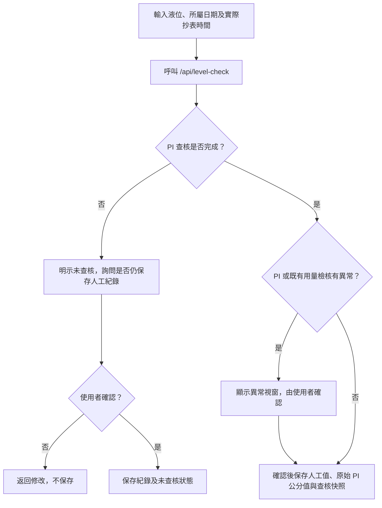

# 冷卻水與鍋爐藥品管理系統
## PI 線上液位輔助查核與線性校正系統 — 結案查核與修正報告

**專案名稱**：冷卻水與鍋爐藥品管理系統 (WTCA) - PI 線上液位輔助查核與線性校正機制  
**執行日期**：2026 年 10 月 05 日  
**主要維護人**：029059  
**版權所屬**：中龍鋼鐵 (Dragon Steel Corporation)  

---

> **2026-10-05 修訂狀態：本機修正、遠端部署與 API 回讀驗證完成；現場跨日操作及量尺一致性仍待驗收。**
> 原功能提交為 `e3d87f9`，原報告提交為 `2411d97`。查核發現實際時間串接、原始 PI 值保存、Tag 錯配及回補保護缺陷，原「全數驗證完畢」結論撤回。本文第 4 節保留查核時的正式機歷史快照，不能當作修正版驗收證據。

## 1. 專案背景與效益摘要

在日常藥品管理作業中，現場同仁每日需抄錄並人工輸入各冷卻循環水（CT-1、CT-2）與鍋爐藥品儲槽之液位數值。然而實務作業面臨以下挑戰：

1. **抄錄輸入時間浮動跨日**：同仁輸入時間常落在每日夜間 23:00 至隔日下午 14:00 之間，直接比對 00:00~00:00 日消耗量與線上儀表存在時間差困難。
2. **人工登錄失誤風險**：現場容易發生「一階/二階欄位填反」、「小數點打錯（例如縮小 10 倍或放大 10 倍）」或「看錯數字」等輸入人為疏失。
3. **現場液位與線上儀表存在高差與偏置**：各儲槽現場感測器與 PI 儀表之間，配對資料呈現偏移；安裝基準、時間配對與單位設定均可能影響結果，不能僅由截距推定物理原因。

### 導入成果效益：
- **自動化防呆檢核**：於點擊「批次儲存所有輸入」時自動同步對照 PI 線上數據，異常時即時提示「請確認是否 KEY 錯欄位或數字」。
- **動態時間正規化**：透過時間長度等比折算演算法，依兩次實際抄表時間比對 24 小時等效耗藥量；前次時間不明時標示估算。
- **儲槽專屬線性校正**：依有效且具有實際抄表時間的配對資料，在使用者觸發重算／回補時擬合校正公式（\(y = a \cdot x + b\)）；3～6 筆或 PI 變化範圍不足 20 cm 時僅修正偏移，不宣稱完成線性回歸。
- **補藥智慧辨識**：自動分析 PI 階躍趨勢，提供補藥候選提示，仍需現場確認。

---

## 2. 檔案異動與架構說明

原功能提交 `e3d87f9` 共異動 13 個檔案，新增 2,058 行、刪除 28 行；以下為原提交範圍，本次修正另見第 7 節：

### 2.1 新增模組

| 檔案路徑 | 模組職責說明 |
| :--- | :--- |
| `levelCheck.js` | **核心計算引擎**：負責單位換算、定點內插、24 小時用量正規化、一二階防呆、小數點錯位檢查、補藥偵測與最小平方法回歸擬合（OLS）。 |
| `components/PiCalibrationModal.tsx` | **校正管理彈窗 UI**：展示各儲槽校正公式、殘差標準差、樣本數，支援手動調校參數、歷史調校歷程查詢與歷史數據批次回補觸發。 |
| `tests/levelCheck.test.mjs` | **自動化單元測試**：包含 10 項嚴格測試案例，涵蓋數值邊界、異常偵測、補藥過濾與回歸準確度驗證。 |
| `deploy.mjs` | **自動化佈署腳本**：自動建立伺服器備份、透過 Robocopy 鏡像同步至遠端生產伺服器（`\\10.122.51.61\c$\inetpub\wwwroot\WTCA`）。 |
| `.ignore` | **架構圖譜設定**：配合 graft 索引工具設定本地快取排除規則。 |

### 2.2 修改模組

| 檔案路徑 | 調整內容說明 |
| :--- | :--- |
| `App.tsx` | 1. 手動輸入頁面：移除原頂部獨立檢查按鈕，改為點擊「批次儲存所有輸入」時自動連帶呼叫 PI 檢查，並提供動態載入回饋。<br>2. 參數設定頁面：新增專屬「PI 線上液位校正公式與調校歷程」設定卡片。 |
| `server.js` | 1. 資料庫：建立 `tank_calibrations`、`tank_calibration_logs` 資料表與 `readings.pi_level_cm` 欄位。<br>2. API：新增 `/api/level-check`、`/api/tank-calibrations`、`/api/admin/backfill-pi-levels` 與重啟端點。<br>3. 效能：將 PI 擷取指令整合為批次單一處理程序，大幅縮短響應時間。 |
| `components/ImportAnomalyModal.tsx` | 強化防呆告警 UI，當判定數值超出容許範圍時，明確顯示「**請確認是否KEY錯欄位或數字**」。 |
| `services/apiService.ts` | 封裝校正公式查詢、手動修改、重新計算與歷史回補等前端 API 調用函式。 |
| `services/storageService.ts` | 增補本地及伺服器資料儲存與讀取介面支援。 |
| `types.ts` | 定義校正模型、調校歷史日誌、儲槽設定及檢查結果之 TypeScript 型別結構。 |
| `views/WaterQualityTrendsView.tsx` | 修正水質趨勢畫面中的 TypeScript 嚴格型別定義。 |
| `.gitignore` | 排除本地 graft graph 圖譜快取目錄。 |

---

## 3. 核心演算法與防呆機制

### 3.1 儲槽專屬線性校正模型
將 PI 線上儀表讀值（\(x\)）轉換為現場手動計量液位（\(y\)）：
\[
y = a \cdot x + b
\]
- \(a\)（斜率）：反映儀表量程比例（預設基準為 1.000）。
- \(b\)（截距）：反映現場液位計發送器與桶槽零點之物理安裝高差（cm）。
- \(\sigma\)（殘差標準差）：用於評估現場數據與儀表線性擬合之穩定度。

### 3.2 跨日 24 小時等比正規化
為克服手動輸入時間浮動跨日（前次時間 \(t_1\)、本次時間 \(t_2\)），系統計算兩次輸入間隔 \(\Delta t = t_2 - t_1\)（小時），將實際消耗量折算為 24 小時等效基準：
\[
\Delta h_{24\text{h}} = \Delta h_{\text{actual}} \times \left( \frac{24}{\Delta t} \right)
\]
再與 PI 同一實際時間區間的消耗比對。所屬日期僅作日報歸屬；實際抄表時間由使用者明確填寫，查核與保存共用同一值。前次缺少時間時以業務日期估算並明示，不據此判定人工液位上升異常。

### 3.3 智慧防呆判斷矩陣



---

## 4. 原正式機公式快照與限制

2026-10-05 唯讀查詢正式機 API 時，下列數值與原報告一致。主要儲槽僅有 3 筆配對，依程式規則屬固定斜率 1 的中位數偏移校正（OFFSET），不是 OLS 線性回歸。原回補缺少分段讀取及完整覆蓋率證據，不能據此宣稱已完整回補 35 天。

| 儲槽 ID | 儲槽名稱 | 線性校正公式（\(y = a \cdot \text{PI} + b\)） | 斜率 (\(a\)) | 截距 (\(b\), cm) | 樣本數 | 特徵說明 |
| :--- | :--- | :--- | :---: | :---: | :---: | :--- |
| **`tc1_2`** | CT-1 漂白水 | \(\text{現場液位} = 1.000 \times \text{PI} + 86.24\) | 1.000 | **+86.24** | 3 | 零點偏置約 86.2 cm |
| **`tc2_2`** | CT-2 漂白水 | \(\text{現場液位} = 1.000 \times \text{PI} + 90.66\) | 1.000 | **+90.66** | 3 | 零點偏置約 90.7 cm |
| **`tc1_1`** | CT-1 硫酸 | \(\text{現場液位} = 1.000 \times \text{PI} + 86.51\) | 1.000 | **+86.51** | 3 | 零點偏置約 86.5 cm |
| **`tc2_1`** | CT-2 硫酸 | \(\text{現場液位} = 1.000 \times \text{PI} - 3.13\) | 1.000 | **-3.13** | 3 | 零點偏置約 -3.1 cm |
| **`tc1_4`** | CT-1 分散劑 | \(\text{現場液位} = 1.000 \times \text{PI} + 54.85\) | 1.000 | **+54.85** | 3 | 零點偏置約 54.9 cm |
| **`tc2_4`** | CT-2 分散劑 | \(\text{現場液位} = 1.000 \times \text{PI} + 38.87\) | 1.000 | **+38.87** | 3 | 零點偏置約 38.9 cm |
| **`tc1_3`** | CT-1 腐蝕結垢抑制劑 | \(\text{現場液位} = 1.000 \times \text{PI} + 49.78\) | 1.000 | **+49.78** | 3 | 零點偏置約 49.8 cm |
| **`tc2_3`** | CT-2 腐蝕結垢抑制劑 | \(\text{現場液位} = 1.000 \times \text{PI} + 44.58\) | 1.000 | **+44.58** | 3 | 零點偏置約 44.6 cm |
| **`tc2_5`** | CT-2 銅腐蝕抑制劑 | \(\text{現場液位} = 1.000 \times \text{PI} + 9.18\) | 1.000 | **+9.18** | 3 | 零點偏置約 9.2 cm |
| **`tc1_5`** | CT-1 銅腐蝕抑制劑 | \(\text{現場液位} = 1.000 \times \text{PI} - 3.24\) | 1.000 | **-3.24** | 3 | 零點偏置約 -3.2 cm |
| **`tc2_6`** | CT-2 非氧化型殺菌劑 | \(\text{現場液位} = 1.000 \times \text{PI} + 3.79\) | 1.000 | **+3.79** | 3 | 零點偏置約 3.8 cm |
| **`tc1_6`** | CT-1 非氧化型殺菌劑 | \(\text{現場液位} = 1.000 \times \text{PI} - 1.55\) | 1.000 | **-1.55** | 3 | 零點偏置約 -1.6 cm |
| **`tb_2`** | 鍋爐中和胺 | \(\text{現場液位} = 1.000 \times \text{PI} + 5.31\) | 1.000 | **+5.31** | 3 | 零點偏置約 5.3 cm |
| **`tb_1`** | 鍋爐清罐劑 | \(\text{現場液位} = 1.000 \times \text{PI} - 3.53\) | 1.000 | **-3.53** | 3 | 零點偏置約 -3.5 cm |
| **`tb_3`** | 鍋爐脫氧劑 | \(\text{現場液位} = 1.000 \times \text{PI} + 1.63\) | 1.000 | **+1.63** | 3 | 零點偏置約 1.6 cm |
| **`tc1_7` / `tc2_7`** | 微生物分散劑 | \(\text{現場液位} = 1.000 \times \text{PI} + 0.00\) | 1.000 | **0.00** | 0~1 | 原正式機誤配同階分散劑 Tag；修正版遷移將清除錯配並保留備份 |

> **解讀限制：** 上表僅為歷史偏移估計。大截距無法單獨證明液位計安裝高差，也不能證明現場量尺一致；需核對正確 Tag、單位與實際抄表時刻，再以獨立樣本驗證。

---

## 5. 原提交驗證記錄及本次查核界線

1. **單元測試（Unit Test）**：
   - 執行腳本：`node tests/levelCheck.test.mjs`
   - 測試結果：10 項單元測試全數通過（`10 pass, 0 fail`）。
2. **生產環境編譯（Production Build）**：
   - 執行指令：`npm run build`
   - Vite 編譯與 TypeScript 檢查須分開執行；`npm run build` 本身不執行型別檢查。本次另執行 `npx tsc --noEmit`。
3. **生產伺服器鏡像佈署（Deploy）**：
   - 執行指令：`node deploy.mjs`
   - 佈署目標：`\\10.122.51.61\c$\inetpub\wwwroot\WTCA`
   - 備份與鏡像同步：前端 `dist/`、後端 `server.js`、`levelCheck.js` 與前端源碼全數同步更新。
4. **伺服器服務重啟（Server Restart）**：
   - 原報告的歷史重啟證據未補得；本次修正版已依第 8 節實際停止、部署及啟動服務，確認最終為 RUNNING。
5. **程式碼圖譜索引（Code Graph）**：
   - 執行指令：原報告記載 `graft build --deep` 建立 497 個節點與 912 條關係邊；圖譜統計不構成功能驗收。

---

## 6. 版本控制提交紀錄 (Git Commit)

- **提交分支**：`main`
- **提交雜湊 (Commit SHA)**：`e3d87f9`
- **異動統計**：`13 files changed, 2058 insertions(+), 28 deletions(-)`
- **Commit 訊息**：
  ```text
  feat: 整合 PI 線上液位線性校正公式、儲存自動防呆檢查與歷史數據回補機制

  - 新增 levelCheck.js: 定點比對、24h 消耗正規化、一二階防呆、補藥偵測與線性迴歸擬合 (y = ax + b)
  - 新增 PiCalibrationModal.tsx: 校正公式檢視、手動調校與調校歷程查詢視窗，並整合回補歷史數據按鈕
  - 調整 App.tsx: 手動輸入點擊「批次儲存所有輸入」時自動連帶呼叫 PI 檢查；將公式檢視功能移至「參數設定」頁面
  - 擴充 server.js: 支援資料表 (tank_calibrations, tank_calibration_logs, readings.pi_level_cm) 與回補 API，並優化批次擷取 PI 歷史數據
  - 完善 ImportAnomalyModal.tsx: 當手動輸入與 PI 換算差距過大時提示「請確認是否KEY錯欄位或數字」
  - 新增 tests/levelCheck.test.mjs: 包含 10 項單元測試並全數通過
  - 新增 deploy.mjs: 自動化備份與遠端鏡像佈署腳本
  ```

---
## 7. 本次修正與驗收條件

- **原始 PI 值**：保存 `piRawCm`，不再將已校正 `piRefCm` 當成回歸自變數；覆寫紀錄時清除失效的舊 PI 配對，保留數值 0。
- **實際時間**：新增台北時間抄表欄位；前後端共用同一時刻。前次查詢嚴格排除當日紀錄，擷取範圍涵蓋實際前次時刻。
- **錯配資料修復**：新增 `levelCheckPersistence.js`，在啟動遷移交易內將確認錯配的 `tc1_7`／`tc2_7` Tag 清空，失效配對與公式不再使用；其原始列保存至 `pi_level_repair_audit`。重新啟動不會重做或覆蓋後續人工修正。
- **歷史資料界線**：可辨識的校正值錯存由原查核快照還原。舊版快照未保存查核時刻，無法證明原 `read_at` 正確；備份後標為未知，不猜測歷史時間。缺少實際時間的資料不加入新回歸或 PI 回補，需人工核實後重新登錄。原有公式保留作待驗證設定，不能視為已重新校正。
- **公式保存**：區分 LINEAR、OFFSET、NONE 與 MANUAL；相容舊 AUTO 線性公式的 3σ 容差。少於 3 筆有效配對不覆寫公式；重算公式及異動日誌同一交易提交。
- **回補保護**：PI 失敗或無有效配對不寫入、不重算；各槽回報更新、略過與錯誤。部分成功不顯示全槽完成；超過 20,000 點時二分時間區間並去除邊界重複點。超時或無法完整取得仍視為失敗。
- **未查核提示**：連線失敗、未設定 Tag 或沒有資料會明示未完成 PI 查核，由使用者決定是否仍保存人工紀錄。
- **部署腳本**：納入新後端模組與備份；備份失敗即停止。備份時間使用台北時區。

### 本機驗證

執行 `node --test tests/levelCheck.test.mjs tests/levelCheck.integration.test.mjs`，24 項測試全部通過；`npx tsc --noEmit`、`npm run build`、Node 語法與 Git 差異格式檢查均通過。生產編譯仍有既有大型 bundle 提示。整合測試執行實際前端提交／後端 API 函式，以替身隔離資料庫及 PI，不接觸正式資料；PowerShell 分段測試使用 35 天每分鐘一點，共 50,401 點。未以真實 PostgreSQL 或正式 PI 執行端到端驗收。

### 尚待現場驗收

本次修正版已部署並完成下列伺服器端驗證。仍需現場測試實際跨日輸入、歷史補登、PI 斷線及回補結果；歷史時間與正確微生物分散劑點位必須由現場證據確認。未將此次 API 回讀等同於完整操作驗收。

## 8. 2026-10-05 遠端部署紀錄

- **目標**：`\\10.122.51.61\c$\inetpub\wwwroot\WTCA`，服務 `W52_WTCA`。
- **備份目錄**：`deploy-backups\20261005-162610-pi-level-fix`，含原部署檔案、資料庫備份與驗證 JSON。
- **資料庫預檢**：在遠端真實 PostgreSQL 中執行修復交易，確認 SQL 成功後 ROLLBACK；預檢不保留資料異動。
- **部署流程**：確認服務 STOPPED，備份 20 個儲槽、14,910 筆讀值、17 組公式與 35 筆校正日誌；複製本次範圍檔案後，確認 16 個部署檔案 SHA-256 一致，再啟動服務並確認 RUNNING。
- **前端驗證**：首頁 HTTP 200，載入 `index-ChQRB93-.js` 新版資源。
- **資料修復回讀**：`tc1_7`、`tc2_7` 的錯配 Tag 均為空；兩槽共 1,163 筆紀錄已標示 NO_PI，沒有殘留的 PI 配對值；新增兩筆 RESET_INVALID_TAG 日誌。
- **人工資料保全**：逐筆比對備份與正式 API 的儲槽、日期、人工液位、體積、重量、比重、合約、補藥量及操作人員，14,910 筆全部一致。本次實際清除的舊抄表時間為 0 筆。
- **證據檔案**：備份目錄內的 `preflight-result.json`、`backup-result.json`、`deployed-sha256.json`、`api-verification.json`、`manual-data-verification.json`。
- **清理**：一次性伺服器驗證服務已刪除，正式服務保持 RUNNING。

**結案狀態**：程式修正與部署完成；現場操作及量尺比對驗收完成前，不作全面功能結案簽署。
